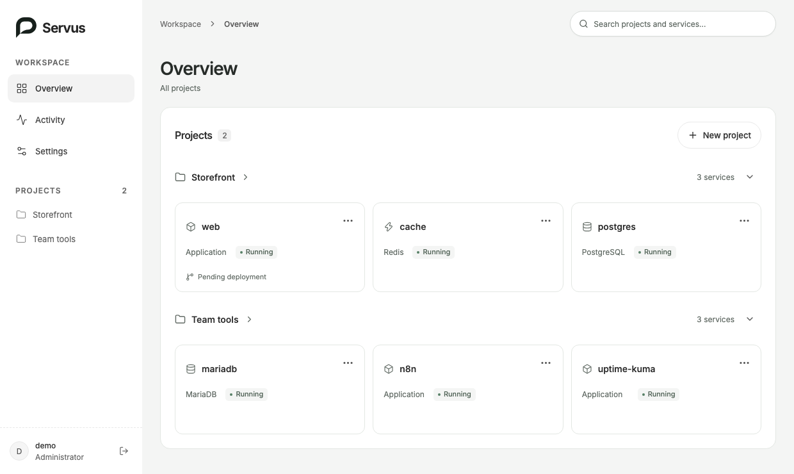

# Servus

Servus is a self-hosted web panel for Docker apps and databases. Use it to run a site with its database or host internal tools like n8n on a Linux server you control.



## What you can do

Projects group related services. Build an app from a Git repository with a Dockerfile, pull an image from a registry, or bring a Docker Compose file. WordPress and n8n have templates.

Give an app its own domain and enable automatic HTTPS once DNS and ingress are set up. Run PostgreSQL, MariaDB or Redis on the project's private network and schedule database backups to local storage or an S3-compatible destination.

When a deployment fails, open the logs in the browser. You can also redeploy an earlier image from the service's deployment history.

## VPS installation

Use a supported Ubuntu or Debian VPS with systemd. The installer sets up Docker if needed. To install from this repository, run the following commands on the server.

```sh
git clone https://github.com/raxon/servus.git
cd servus
sudo bash scripts/install.sh --source "$PWD"
```

When installation finishes, open the panel URL printed in the terminal and create your administrator account. The panel uses port `4180` by default. Restrict access during setup because the first visitor can create the administrator account.

See the [VPS installation guide](deployment/README.md) for supported OS versions, signed releases, custom ports and HTTPS for the panel itself. To try Servus on your Mac, see [Run locally](#run-locally).

## Deploy an application

Try Nginx on your [local installation](#run-locally).

1. Select **New project**, name it `getting-started`, and select **Create project**. On the project page, select **New service**.
2. Select **Application** and **Docker image**. Name the service `welcome`, set the image to `nginx:alpine`, and use `welcome.localhost` as the hostname with container port `80`.
3. Select **Create & deploy** and follow the deployment until it succeeds.
4. Open <http://welcome.localhost:18080>.

On a VPS, replace `welcome.localhost` with a hostname that points to the server. The VPS installer serves applications on HTTP port `80` by default.

To check local routing directly, send a request with the app's hostname.

```sh
curl -H 'Host: welcome.localhost' http://127.0.0.1:18080
```

For Git, select a public HTTPS repository, branch or ref, build context such as `.` and Dockerfile path such as `Dockerfile`. Build paths must remain inside the repository. Successful Git deployments record the source commit and image identifier.

SSH deploy keys require an administrator. Save an `ssh://git@host/owner/repository.git` source with a verified Ed25519 `known_hosts` entry, then add the generated public key to the repository before deploying. Host-key changes create an encrypted reference while existing deployment snapshots retain their previous reference. Each service keeps its own registry credentials. When pulling an image or recovering a deployment, Servus checks its registry against the original credential record and sends authentication separately from the Docker specification. API responses contain references.

**Save** records desired settings. **Deploy** applies them. Start and restart use the deployed configuration, while stop sets runtime replicas to zero and retains the saved settings. A failed application update can restore the preceding runtime specification. It cannot undo database migrations or external side effects.

## Supported operations

| Area               | Current behavior                                                                                                            |
| ------------------ | --------------------------------------------------------------------------------------------------------------------------- |
| Access             | One-time administrator setup, cookie sessions, CSRF and origin checks, project access checks                                |
| Projects           | Create, list, rename, edit descriptions and delete empty projects                                                           |
| Applications       | Public or private Docker images, HTTPS Git credentials and administrator-managed SSH deploy keys with pinned host keys      |
| Configuration      | Saved and deployed revisions, encrypted secrets, optional generated env files, multiple domains, CPU/RAM limits and replicas |
| Storage            | Named volumes, immutable read-only configuration files and administrator-approved bind paths                                |
| Databases          | PostgreSQL 17, Redis 7 and MariaDB 11.4 presets with private project networking and persistent data                         |
| Operations         | Deploy, start, stop, restart and destroy actions with durable events and failure details                                    |
| Runtime inspection | Current CPU, RAM and network samples, container lists, recent logs, live log streaming and an interactive `/bin/sh` console |
| Recovery           | Durable agent operation journal and restoration of the previous application specification after a failed deployment         |

Application HTTPS, private Git credentials, GitHub repository and branch selection, Force Rebuild, database backups and project API tokens are implemented. The CLI and stdio MCP server use the same HTTP operations and project permissions. See [automation](docs/automation.md) for setup.

Create reusable destinations for backups in **Settings > Backup storage**. Database schedules run in UTC. You can keep a fixed number of copies, keep them for a set period, or retain copies across hourly, daily, weekly, monthly and yearly windows. Database backups can be encrypted at rest with the installation's key. Keep the installation key and backup metadata for recovery. Servus verifies and decrypts these files when you download them for restore.

Export and restore are in the database's **Backups** tab. For PostgreSQL, MariaDB or Redis, prepare an isolated candidate and confirm the switch after its checks succeed. Redis retains the previous volume and can roll back to it. Its journal also helps recover an interrupted restore. Provider acceptance uses MinIO. R2 account testing remains pending.

On a single-node Swarm, application volume backups stop the application, capture one writable named volume and restore its previous replica count before marking the backup complete. Restores use a fresh volume. Confirm the switch in Backups after preparation succeeds. Servus retains the original volume for rollback, which requires the runtime specification to still match the recorded operation. Archives preserve file content, modes and numeric ownership, with regular file timestamps and confined relative symlinks also checked during recovery. Each archive is limited to 2 GiB and covers the selected application volume, while database volumes and panel configuration require their own backup and recovery procedures.

Compose accepts inline YAML or public HTTPS Git sources and keeps named volumes after removal. With Git, builds use a pinned checkout and support relative context paths, Dockerfiles, build arguments and targets, while inline definitions can supply a Dockerfile for an empty build context. Each operation records the built image. Restart and rollback reuse that image without fetching the repository or rebuilding, and domains use the same Traefik ingress and certificate retry flow as application services. Private Git remains unsupported. So do published ports, host mounts and privileged Compose settings. Starter templates create WordPress, n8n, Uptime Kuma, Grafana and MinIO through the same deployment path.

Local accounts can enable an authenticator and receive ten one-use recovery codes. Git deployment webhooks support GitHub signatures, branch matching and server-generated credential rotation. Settings now shows release notes before an update is confirmed.

Administrators can request a named installation backup in Settings on a configured supervised host. The host stops the control plane, captures panel configuration and encrypted secrets, then checks the restarted processes before reporting completion. Back up application data separately. Interrupted operations require explicit recovery on the host, and history, retention and signed-release acceptance remain pending.

Historical monitoring, additional builders, managed MySQL/MongoDB and multi-node management remain unfinished. The [parity backlog](spec/parity/backlog.md) tracks these gaps and release verification.

## Requirements

Use Node.js 24, the npm version declared in the root `packageManager` field and a Linux Docker Engine available to the agent with Swarm manager privileges. The macOS workflow also requires Docker CLI, its Buildx plugin and Colima. Servus listens on port 4180 and application HTTP ingress on port 18080.

Choose a dedicated test daemon. The agent can initialize Swarm and create ingress services, so this pilot assumes trusted operators with Docker administration rights.

## Run locally

On macOS:

```sh
nvm use
npm ci
npm run local:vm
```

This starts the separate Colima profile `panel-dev`, builds Servus and supervises the API, worker and agent. Your selected Docker context stays unchanged. Existing VM data and deployed services are retained.

Source builds use `docker buildx`. If `DOCKER_CONFIG` is unset, the local supervisor detects the Homebrew plugin at `/opt/homebrew/lib/docker/cli-plugins/docker-buildx` and writes a local plugin configuration under `.data/docker-config/`.

Open <http://localhost:4180> and create the first local administrator with an email address and a password of at least 8 characters. Until setup is complete, restrict access to the panel to the administrator: anyone who can reach an unconfigured instance can create the first account. Control-plane data and encrypted secret files live under `.data/`, which is excluded from Git and the Docker build context.

For an existing local Linux Docker daemon:

```sh
nvm use
npm ci
PANEL_DOCKER_SOCKET=/var/run/docker.sock npm run local
```

Stop the supervised processes with Ctrl+C. You can stop the dedicated VM separately with `colima stop panel-dev`. Neither operation deletes application volumes.

## Configuration and data

Environment entries have unique names. The text editor accepts `KEY=value`, blank lines and `#` comments. Single quotes preserve literal values, and double-quoted values use JSON escapes such as `\n`. Raw multiline blocks, shell expansion and `export` statements are unsupported.

Secret entries are stored encrypted and returned as `secretRef` identifiers. Existing values stay masked until explicitly replaced. Keep those references when submitting a complete environment array through the API. Removing an entry from that array removes it from desired configuration. Secret values reach the running workload, so operators with Docker access can inspect its environment.

Each domain maps a hostname to a container port, with at most one primary domain. Automatic application HTTPS requires configured ingress and a reachable public domain. The panel provides DNS and TLS checks, certificate status and retry actions. Test production issuance and renewal on your deployment before depending on them. An empty domain list keeps the application on its private project network.

Force Rebuild bypasses the Docker build cache for that deployment. Its option is recorded with the action, so a recovered action keeps the same request. Later start, restart and historical image deployments do not inherit it. An optional generated env file is written inside the Git build context, and can contain secrets included in the built image. Keep it out of final image layers unless the application requires it.

Writable volumes and database services require one replica. Application CPU limits accept 0.1 to 64 cores, memory limits 32 to 131072 MiB, and stateless application replicas 1 to 5. Bind mount sources must be existing paths nested under `PANEL_MANAGED_BIND_ROOT`, which defaults to `/var/lib/panel/mounts`, on the Docker host. Configure the same approved root in the API and agent.

Databases are private by default. The connection panel shows an internal address for other services in the project. An administrator can save an external TCP port there and apply it with **Deploy**. Restrict the port in the host firewall and configure database TLS as needed. PostgreSQL and MariaDB initialize the selected database and user. Redis uses logical database 0 and its default user. Servus generates a password when you leave it blank, and reveals it only on request.

Database names, users and passwords are immutable after creation. Image changes are blocked after a database has been deployed. Credential rotation and database upgrade migrations need separate workflows and are not implemented.

Destroy removes a service and its HTTP routes while retaining managed volumes and action history. Delete an empty project after removing its services. Retained data needs explicit operator cleanup when it is no longer required.

## API contracts

All endpoints use `/api/v1`. Authentication uses a session cookie. Read the `csrfToken` from setup, login or session responses and send it as `X-CSRF-Token` on authenticated mutations. Service creation, lifecycle actions and service deletion also require an `Idempotency-Key`. Reuse that key only when retrying the same request.

| Endpoint                                                   | Contract                                                         |
| ---------------------------------------------------------- | ---------------------------------------------------------------- |
| `GET /setup`, `POST /setup`                                | Setup status, then `{email,password}`                      |
| `POST /auth/login`, `GET /auth/session`                    | Login accepts `{email,password}`, both return `{user,csrfToken}` |
| `GET/POST /projects`                                       | List or create projects                                          |
| `GET/PATCH/DELETE /projects/:id`                           | Read, edit or delete an empty project                            |
| `GET/POST /projects/:id/services`                          | List services or create one and return `{service,action}`        |
| `GET/PATCH/DELETE /services/:id`                           | Read, save configuration or queue a destroy action               |
| `POST /services/:id/deploy`, `/start`, `/stop`, `/restart` | Queue an action                                                  |
| `GET /services/:id/actions`, `GET /actions/:id`            | Action list or `{action,events}`                                 |
| `GET /services/:id/metrics`, `/containers`, `/logs`        | Current runtime data, with log tails capped at 500 lines         |
| `GET /services/:id/logs/stream`                            | Session-authenticated SSE messages containing `{lines:string[]}` |
| `GET /services/:id/connection`                             | Deployed database connection without a password                  |
| `POST /services/:id/connection/reveal`                     | Explicit authorized password reveal                              |
| `POST /services/:id/console-ticket`                        | `{containerId,shell:"/bin/sh"}` returns a single-use ticket      |

Configuration updates require `expectedRevision`. A stale revision returns HTTP 409. Arrays supplied in a patch replace the corresponding desired collection. The typed request shapes are defined in `apps/panel/src/shared/types.ts`, and validation rules in `apps/panel/src/server/configuration.ts`.

Open a WebSocket to `/api/v1/services/:id/console` with the session cookie and an allowed Origin. Send `{type:"authenticate",ticket}` as the first text message, then wait for `{type:"ready"}` before sending input or resize messages. Tickets in the URL are rejected, so clients using the old `?ticket=...` format must be updated.

After the ready message, input packets use `{type:"input",data}`, resize packets use `{type:"resize",cols,rows}`, and output is raw terminal data. Reloading or leaving the console closes its connection. HTTP API errors use `{error:{code,message}}`.

## Docker Compose packaging

Servus includes a multi-stage Dockerfile and `compose.yaml`. The API and worker do not mount the Docker socket. The agent needs the socket and its host group ID.

From an isolated Linux Docker environment:

```sh
export DOCKER_GID=$(stat -c '%g' /var/run/docker.sock)
docker compose build
docker compose up -d
```

Open <http://localhost:4180> and create the first local administrator, or sign in if setup is complete.

The `panel-data` volume stores SQLite, agent state and secret material. Keep live SQLite files on local storage. This root Compose package binds the management interface to localhost. The VPS installer has separate port and host settings described in its installation guide. Configure management HTTPS and secure cookies before exposing the panel publicly, and decide separately whether application ingress should be reachable remotely.

The recorded package verification covers a Linux ARM64 image with Node.js 24 and Docker 29. It includes a real deployment, Git clone and BuildKit build inside the Linux package. Other architectures need their own verification.

## Monorepo

The repository uses npm workspaces and Turborepo. Run commands from the repository root with Node.js 24 and the npm version pinned in `package.json`.

```text
apps/panel/       API, worker, Docker agent and React management interface
apps/website/     React website and Cloudflare static asset configuration
scripts/          Local supervisor, installer and integration tools
deployment/       Linux installation package
tests/install/    Host-safe installer tests
spec/parity/      Comparison scenarios
```

Each app builds into its own `dist` directory. The root `.data` directory keeps local projects, authentication state and secrets in place. Source paths changed during the workspace migration, but the existing local state directory is retained.

See [AGENTS.md](AGENTS.md) for contribution instructions and [the architecture notes](docs/architecture.md) for process boundaries.

## Website

In one terminal, start the local panel with `npm run local`. In another, run:

```sh
npm run dev
```

This starts the panel frontend on <http://localhost:4181> and the React website on <http://localhost:4182>. Use `npm run dev:website` to work on the website alone. Its basic assets and fonts are local.

The website's `public/install.sh` is generated from `scripts/install.sh` before development and builds. Edit the canonical script, then run its tests. Do not maintain a second installer copy by hand.

Cloudflare configuration is in `apps/website/wrangler.jsonc`. Package it without publication using:

```sh
npm run check:cloudflare
```

Publishing requires an authenticated Cloudflare account with access to the `servus.run` zone. After deployment has been authorized, log in locally and publish:

```sh
npx wrangler login
npm run deploy:website
```

The website deployment is independent of the VPS panel. A successful local build or dry run does not confirm public DNS, HTTPS or installer availability.

## Development and verification

```sh
npm run typecheck
npm test
npm run build
npm run smoke
```

The smoke check creates a real project and Nginx service in the dedicated instance. It exercises lifecycle operations and recovery after a bad port change. If setup is needed, it saves a randomly generated administrator password to `.data/local-credentials.json` with mode 0600 and does not print it.

The expanded fixture suites share a run ID:

```sh
export PARITY_RUN_ID=local-20261113
npm run test:integration
npm run test:parity
npm run test:advanced
npm run test:access
npm run test:reference-failures
npm run test:restart
```

These commands require the local fixture Git server, test images and two isolated Docker contexts. Follow [the reproduction scenarios](spec/parity/scenarios.md) for prerequisites, operator recovery and the full replay after VM restart. Keep the same run ID throughout. Access checks run both before and after restart.

Run the six storage and replica checks after the VM restart, without the replay flag, then generate the local report:

```sh
env -u PARITY_REPLAY npm run test:storage
npm run report:parity
```

Storage checks create disposable bind services after the reboot and verify persistence through API service restart, read-only behavior, symlink escape rejection and two real replicas. This does not claim that those bind fixtures existed during the VM reboot. The report writes `artifacts/parity/<run-id>/index.html` and `summary.json`, preserving recorded reference failures and marking missing required evidence as pending. A unit test count alone does not establish parity or certify the complete product.

For separate panel processes, run `npm run dev:api`, `npm run agent` and `npm run worker`, using the same `PANEL_DATA_DIR`. Start the frontend with `npm run dev:panel`. Set `PANEL_DOCKER_SOCKET` for the agent. The panel Vite server proxies API and WebSocket requests to port 4180. Environment files are not loaded automatically.

The API commits configuration and jobs together. The worker owns orchestration leases, and the agent journals operation IDs before talking to Docker. Recovery inspects or resumes the same operation after an interruption. Browser builds retain earlier hashed assets so an already open tab can still load its console module.

## License

Servus is available under the PolyForm Noncommercial License 1.0.0. See [LICENSE](LICENSE) for the terms. Dependencies retain their own licenses. Servus runs without an activation server.
